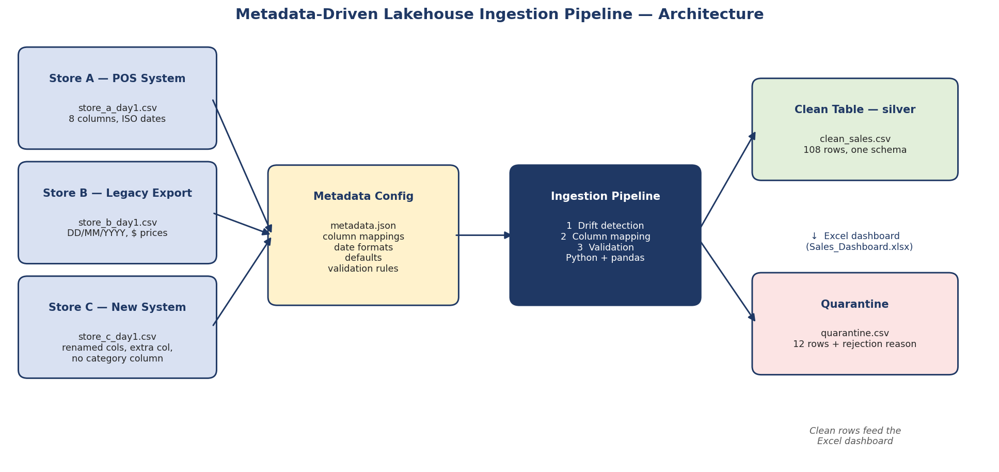
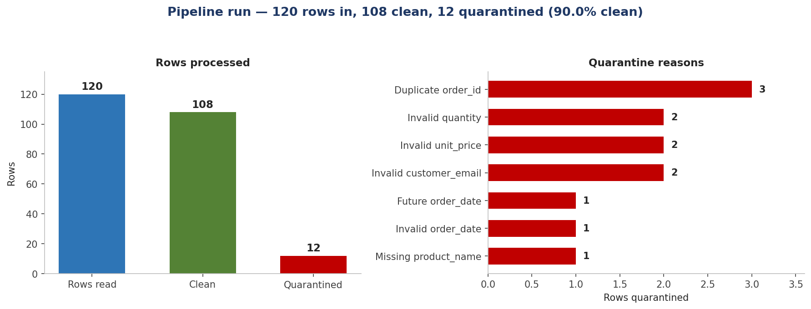
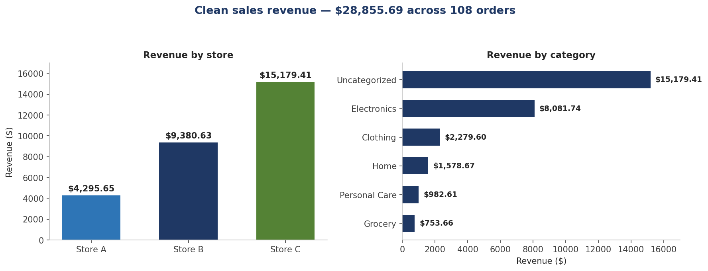

# Metadata-Driven Lakehouse Ingestion Pipeline with Schema Drift Handling

One metadata configuration drives ingestion for three differently-shaped
store feeds — detecting schema drift, validating every row, and loading one
unified clean table while quarantining bad rows with a reason.

> **Portfolio project.** This is a self-directed portfolio project built
> with fictional sample data. It demonstrates a Microsoft Fabric design
> pattern; it was not built for a real client or employer.



## The business problem

NorthMart Retail Group (a fictional retailer) receives a daily sales CSV
from each of its three store systems. Every system exports a **different
schema**, and the schemas drift over time:

- **Store A — POS System:** clean headers close to the target schema,
  ISO dates (`2026-01-19`).
- **Store B — Legacy Export:** different headers, day-first dates
  (`29/01/2026`), `$` signs in prices.
- **Store C — New System:** renamed columns, `Jan 11, 2026` dates, an
  extra `Discount_Pct` column, an unmapped `ItemGroup` column — and **no
  category column at all**.

Hand-writing a pipeline per file does not scale: every rename or new column
means another code change, and bad rows either crash the load or slip
through silently. This project solves it the way production Fabric
pipelines do — with **metadata**.

## Architecture overview

```
data/raw/*.csv          config/metadata.json
  (bronze)                  (mappings, date formats,
   3 store feeds             defaults, validation rules)
        \                          /
         └──── src/pipeline.py ────┘
              drift detection → column mapping → validation
                        /                \
        outputs/clean_sales.csv    outputs/quarantine.csv
          (silver, 108 rows)        (12 rows + reason)
                        \
                 outputs/Sales_Dashboard.xlsx
```

1. **Bronze (raw):** the three source CSVs land untouched in `data/raw/`.
2. **Metadata-driven transform:** `src/pipeline.py` reads
   `config/metadata.json` and, for each file, detects drift, maps columns
   to the unified schema, coerces types, and validates every row.
3. **Silver (clean):** valid rows land in one unified table,
   `outputs/clean_sales.csv`, with `line_total` computed
   (`quantity × unit_price`).
4. **Quarantine:** rejected rows go to `outputs/quarantine.csv` with their
   source file and a specific rejection reason — nothing is silently
   dropped.
5. **Reporting:** `src/build_dashboard.py` builds an Excel dashboard with
   live formulas and charts over the clean table.

## How schema drift is handled

The pipeline compares each file's actual columns against the metadata
mapping and reports three things per file: columns **mapped**, columns
**extra** (ignored), and columns **missing** (defaulted). A rename is
simply a mapping entry — no code change.

**Concrete example — Store C.** Its file has `TxnID`, `SaleDate`,
`Outlet`, `Item`, `Qnty`, `Rate`, `MailID` (all renamed), plus
`Discount_Pct` and `ItemGroup`, which are not in the mapping, and no
category column. The drift report for `store_c_day1.csv` reads:

- Columns mapped: 7 (`TxnID`, `SaleDate`, `Outlet`, `Item`, `Qnty`,
  `Rate`, `MailID`)
- Extra columns ignored: `ItemGroup`, `Discount_Pct`
- Missing columns defaulted from metadata: `category = "Uncategorized"`

The load continues, and all 38 clean Store C rows carry
`category = "Uncategorized"` — visible in the dashboard rather than
hidden.

## Validation rules

Every rule is defined in `config/metadata.json` and enforced by the
pipeline. A row that fails **any** rule goes to quarantine.

| Rule | Checks |
| --- | --- |
| `order_id_present` | `order_id` is non-empty |
| `order_id_unique` | `order_id` is unique across the whole load (all files) |
| `order_date_valid` | `order_date` parses with the source's date format |
| `order_date_not_future` | `order_date` is not after the run date |
| `quantity_range` | `quantity` is a whole number from 1 to 999 |
| `unit_price_positive` | `unit_price` is positive after stripping `$` and `,` |
| `product_name_present` | `product_name` is non-empty |
| `category_present` | `category` is non-empty after defaults are applied |
| `customer_email_format` | `customer_email`, when present, matches `something@domain.tld` |

## Quarantine, not silent failure

Bad data is a business signal, not a crash. Every rejected row is kept in
`outputs/quarantine.csv` with its source file and every reason it failed,
so the store that sent it can fix the problem at the source. In this run,
12 rows were quarantined — 3 duplicate order IDs, 2 bad quantities, 2 bad
prices, 2 bad emails, 1 future date, 1 invalid date, and 1 missing
product name.

## How to run it

```bash
git clone <your-repo-url>
cd fabric-metadata-pipeline
pip install -r requirements.txt

python src/pipeline.py          # ingest, validate, write outputs
python src/build_dashboard.py   # build outputs/Sales_Dashboard.xlsx
python src/make_assets.py       # regenerate the PNGs in assets/
```

Requirements: Python 3.10+ and the packages in `requirements.txt`
(pandas, openpyxl, matplotlib). No cloud account or credentials needed.

## Folder structure

```
fabric-metadata-pipeline/
├── .gitignore
├── README.md
├── requirements.txt
├── assets/
│   ├── architecture.png
│   ├── dashboard.png
│   └── results.png
├── config/
│   ├── README.md
│   └── metadata.json
├── data/
│   └── raw/
│       ├── store_a_day1.csv
│       ├── store_b_day1.csv
│       └── store_c_day1.csv
├── docs/
├── outputs/
│   ├── Sales_Dashboard.xlsx
│   ├── clean_sales.csv
│   ├── quarantine.csv
│   └── run_report.md
└── src/
    ├── build_dashboard.py
    ├── make_assets.py
    └── pipeline.py
```

## Results

Run of 8 November 2026 (`outputs/run_report.md`):

| File | Rows read | Clean | Quarantined |
| --- | ---: | ---: | ---: |
| store_a_day1.csv | 40 | 35 | 5 |
| store_b_day1.csv | 40 | 35 | 5 |
| store_c_day1.csv | 40 | 38 | 2 |
| **Total** | **120** | **108** | **12** |

- **Clean row rate:** 90.0%
- **Total clean revenue:** $28,855.69
- **Revenue by store:** Store A $4,295.65 · Store B $9,380.63 ·
  Store C $15,179.41
- **Average order value:** $267.18
- **Top 5 products by revenue:** Laptop 15-inch 512GB ($11,249.91) ·
  4K Smart TV 55-inch ($2,196.00) · Tablet 10.9-inch 128GB ($1,645.00) ·
  Wireless Noise-Cancelling Headphones ($1,329.93) · Wool Knit Sweater
  ($1,264.77)
- **Quarantine by reason:** Duplicate order_id 3 · Invalid quantity 2 ·
  Invalid unit_price 2 · Invalid customer_email 2 · Future order_date 1 ·
  Invalid order_date 1 · Missing product_name 1





## How this maps to Microsoft Fabric

This reference implementation is Python + pandas so anyone can run it
locally. The design is the same pattern used on Fabric — only the
execution layer changes:

| This project | Microsoft Fabric equivalent |
| --- | --- |
| `data/raw/*.csv` (bronze) | Files in a Lakehouse, landed by a pipeline Copy activity |
| `config/metadata.json` | A metadata table in the Lakehouse (one row per source, per column mapping) |
| `src/pipeline.py` drift detection | A notebook cell comparing `df.columns` with the metadata table |
| Column mapping + type coercion | PySpark `withColumn` / `select` driven by the metadata table |
| Validation rules | PySpark checks (or Great Expectations) writing failures to a quarantine Delta table |
| `silver.clean_sales` CSV | A Delta table in the Lakehouse silver layer |
| `silver.quarantine` CSV | A Delta quarantine table with `rejection_reason` |
| `src/pipeline.py` run | A Fabric pipeline orchestrating notebook activities, on a schedule or trigger |
| `Sales_Dashboard.xlsx` | A Power BI report over the silver Delta table |

Adding a fourth store on Fabric means adding rows to the metadata table —
the notebook and pipeline stay untouched, exactly as adding a `sources`
entry here requires no code change.

## Tech stack

Python · pandas · openpyxl · matplotlib · JSON metadata configuration ·
Microsoft Fabric design pattern (Lakehouse, PySpark, Delta, Power BI) ·
Microsoft Excel

## Author

**Shamstabrej Tamboli** — Microsoft Fabric Data Engineer, Windsor,
Ontario, Canada.
Microsoft Certified: Fabric Data Engineer Associate (DP-700, 2026) ·
Microsoft Azure Data Fundamentals (DP-900, 2026).
Currently Data Management & Analytics at Agriculture and Agri-Food Canada.
